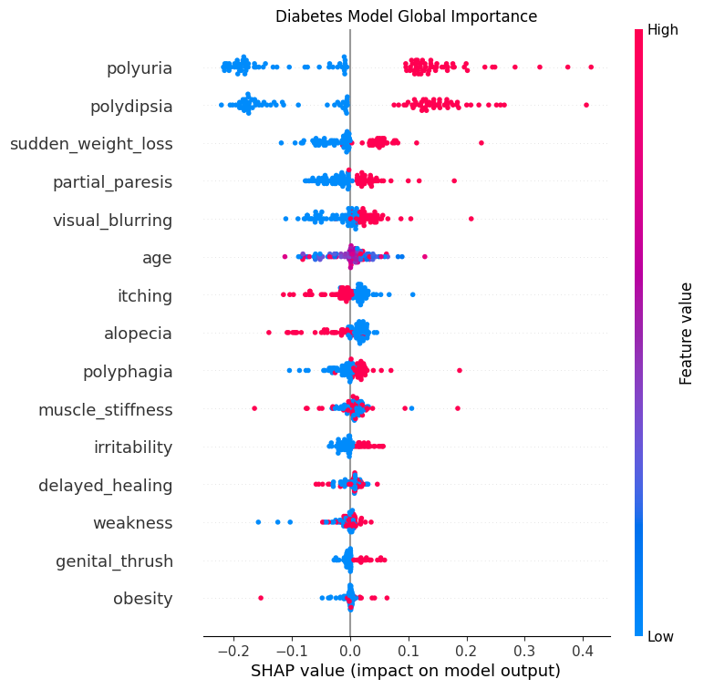
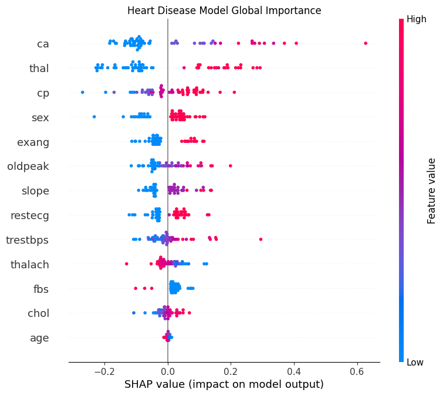
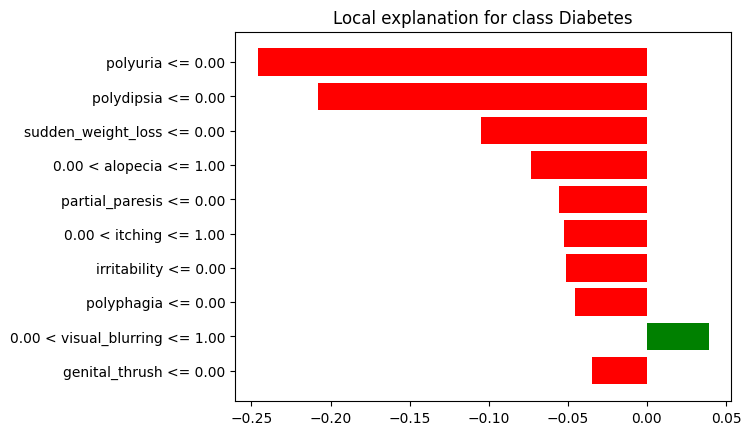

# Explainable AI for Transparent Medical Disease Classification

> **Educational prototype - not a diagnostic tool and not medical advice.**
> The models describe the *existing* disease status recorded in two small public datasets. They do not predict whether a person will develop a disease in the future.

## Contents

1. [Abstract](#abstract)
2. [Quick start](#quick-start)
3. [Project structure](#project-structure)
4. [Introduction](#introduction)
5. [Literature review](#literature-review)
6. [Methodology and implementation](#methodology-and-implementation)
7. [Results](#results)
8. [Implementation status vs. the original plan](#implementation-status-vs-the-original-plan)
9. [Risks and limitations](#risks-and-limitations)
10. [Work plan and expected outcomes](#work-plan-and-expected-outcomes)
11. [References](#references)
12. [Team members](#team-members)

---

## Abstract

This project builds an explainable medical classification system for **diabetes** and **heart disease**. Because the two diseases use different patient information, two separate machine-learning modules are developed.

- The **diabetes** module uses the UCI *Early Stage Diabetes Risk Prediction* dataset (520 records, 16 input features; 15 are used after removing `gender`).
- The **heart-disease** module uses the UCI *Cleveland Heart Disease* dataset (303 records, 13 input features).

For each disease, a **Calibrated Random Forest** and a **Logistic Regression** model are trained and compared. The best model is chosen with 5-fold stratified cross-validation on the training data and then evaluated on a held-out 20% test set using accuracy, precision, recall, F1-score, specificity, ROC-AUC and the Brier score (calibration). **SHAP** (SHapley Additive exPlanations) and **LIME** (Local Interpretable Model-agnostic Explanations) show which features affected each result. A **Streamlit** application lets a user choose a disease, enter the required medical information, receive a classification with a probability, and view SHAP and LIME explanations.

Model performance and explanation quality are treated as separate questions.

## Quick start

**Requirements:** Python 3.10+ and `ucimlrepo shap lime streamlit scikit-learn joblib matplotlib pandas numpy`.

**Google Colab or Jupyter**

1. Open `xai_medical_dashboard.ipynb` and run all cells from top to bottom.
   The notebook installs the packages, writes the source files, downloads both datasets from UCI, trains and saves the models, produces the SHAP/LIME figures, writes `app.py` and (in Colab) launches the app.
2. To run the app outside Colab, after the notebook has run once:

```bash
streamlit run app.py
```

The app needs the files created by the notebook (`data/`, `models/`, `src/`), so run it from the same folder.

## Project structure

```
.
├── xai_medical_dashboard.ipynb   # builds and runs the whole project
├── app.py                        # Streamlit application (written by the notebook)
├── src/
│   ├── data_loader.py            # downloads the two UCI datasets
│   ├── preprocess.py             # cleaning, encoding, 80/20 split, train-median imputation
│   ├── train.py                  # model comparison, CV selection, metrics, saving
│   └── explainers.py             # SHAP and LIME helpers (shared with the app)
├── data/                         # diabetes_data.csv, heart_disease_data.csv
├── models/                       # <disease>_best_model.pkl, <disease>_features.pkl
├── results/                      # <disease>_metrics.csv (full metric tables)
└── images/                       # SHAP / LIME figures
```

---

## Introduction

### 1. Background

Artificial intelligence and machine learning have become increasingly important in healthcare, especially for disease detection, diagnosis and clinical decision support. These systems can find patterns in medical data, but more complex models can be difficult to understand. This has increased interest in **Explainable Artificial Intelligence (XAI)**, which aims to make model decisions easier for people to understand (Amann et al., 2020; Ghassemi et al., 2021).

XAI is not simply about showing a prediction; it also tries to show *why* the model reached it. In healthcare this matters because users may need to understand the factors behind a result before considering it useful or trustworthy. Recent research continues to identify trust, transparency and the quality of explanations as important issues for healthcare AI (Alonso et al., 2025; Alkhanbouli et al., 2025).

### 2. Technology

The project uses machine learning for medical classification. Two classifiers are compared for each disease: a Calibrated Random Forest and a Logistic Regression baseline. SHAP and LIME are the XAI methods: SHAP explains the contribution of each feature to a model prediction, while LIME explains an individual prediction by fitting a simpler local model around that case (Lundberg & Lee, 2017; Ribeiro et al., 2016). Everything is served through a single Streamlit interface.

### 3. Problem statement

Machine-learning models can classify medical conditions, but some give a result without showing why, which makes it harder to understand the model, find errors and judge whether the result can be trusted (Ghassemi et al., 2021).

Recent reviews show that XAI is widely used in disease-related research, but there are still limitations in how explanation quality is evaluated, how consistent explanations are, and how well XAI systems are validated for real-world use (Vimbi et al., 2024; Alkhanbouli et al., 2025). Explanations should also not automatically be treated as proof of medical correctness or causation (Ghassemi et al., 2021).

### 4. Project aim

To build and test explainable machine-learning models for diabetes and heart-disease status and present their results through a simple Streamlit application. Each module has its own dataset, preprocessing, trained models and SHAP/LIME explanations. The application accepts user inputs, returns a classification and probability, and displays visual explanations of the features that influenced the result. The project uses public data only and does not provide treatment advice or replace a doctor.

### 5. Scope

- Two separate modules (diabetes and heart disease), each with its own dataset, preprocessing, models and explanations.
- Collect and prepare the two public datasets; handle missing values; encode features.
- Train and compare models per disease and select the best one on cross-validated performance.
- Explain the selected models with SHAP and LIME.
- Streamlit app: choose a disease, enter medical information, get a classification, and view the main features that influenced it.
- **Out of scope:** hospital records, treatment recommendations, replacing a doctor, and predicting future disease.

### 6. Measurable objectives

Status refers to the code in this repository (see also [Implementation status](#implementation-status-vs-the-original-plan)).

| Objective | Status |
|---|---|
| Prepare and clean one diabetes and one heart-disease dataset | Done |
| Compare classifiers for each disease | Done for Calibrated Random Forest and Logistic Regression (XGBoost was proposed but is not implemented) |
| Stratified 5-fold cross-validation on the training data plus a separate test set | Done |
| Evaluate with accuracy, precision, recall, F1, specificity, ROC-AUC and calibration | Done (calibration measured with the Brier score; no calibration curves) |
| Select the best model per disease from the evaluation results | Done (by cross-validated ROC-AUC) |
| Global and local SHAP explanations, local LIME explanations | Done (global SHAP in the notebook; local SHAP in the app; local LIME in the app and notebook) |
| Compare SHAP and LIME on stability, local fidelity, feature agreement and time | Only **explanation time** is measured |
| Streamlit application for entering data and viewing results and explanations | Done (no formal usability study) |
| Document limitations, possible bias and ethical safeguards | Done (see [Risks and limitations](#risks-and-limitations)) |

### 7. Expected contribution

A working prototype that connects medical classification models with XAI methods. Instead of only showing a result, the application shows the main features that influenced it. Model performance is evaluated separately from explanation quality, and SHAP and LIME are compared as explanation methods.

---

## Literature review

### 1. Algorithms

- **Logistic Regression** is a simple classifier used as the baseline. Its coefficients show how input features relate to the output, but it may miss complex relationships.
- **Random Forest** combines many decision trees and can learn non-linear relationships in tabular data, but individual predictions are hard to trace directly, which makes XAI methods useful. Here it is wrapped in a probability calibrator (`CalibratedClassifierCV`).
- **XGBoost** (boosted trees) was considered in the original proposal because it is strong on structured data. It is **not part of the current implementation**.

### 2. Explainable AI methods

- **SHAP** assigns contribution values to features and can be used both to study the model overall and to explain individual cases (Lundberg & Lee, 2017).
- **LIME** explains an individual prediction by creating a simpler model around that specific case (Ribeiro et al., 2016).

SHAP and LIME are among the most common XAI methods in healthcare, but studies report differences in how explanation quality is evaluated and point to the need for better validation, consistency and user-focused evaluation (Vimbi et al., 2024; Alkhanbouli et al., 2025).

### 3. Limitations of existing XAI in healthcare

Explainability makes model decisions easier to inspect, but an explanation does not prove that a model is medically correct. Ghassemi et al. (2021) discuss cases where explanations create a false sense of trust and argue that strong model validation remains necessary.

A systematic review of XAI explanation effectiveness found that researchers use different measures such as fidelity, interpretability, plausibility, user satisfaction, trust and task performance, with no single standard approach (Jung et al., 2023). Another recent systematic review of XAI in disease prediction identified limited dataset diversity, model complexity and reliance on single data types as continuing challenges (Alkhanbouli et al., 2025).

These findings support treating predictive performance and explanation quality as separate parts of the evaluation.

### 4. Comparison table

| Approach | Main focus | Main strength | Main limitation |
|---|---|---|---|
| Logistic Regression | Classification baseline | Simple and easier to interpret | May miss complex relationships |
| Random Forest | Non-linear classification | Handles complex feature relationships | Individual predictions are harder to trace |
| XGBoost *(proposed, not implemented)* | Boosted tree classification | Strong performance on tabular data | More difficult to interpret directly |
| SHAP | Global and local explanations | Shows feature contributions | Can require more computation |
| LIME | Local explanations | Simple explanation of individual cases | Local explanations can vary between runs |
| This project | Disease classification + XAI + application | Combines prediction and explanations in one workflow | Evaluated on public data, not live hospital data |

### 5. Selected datasets

Both datasets come from the UCI Machine Learning Repository (CC BY 4.0) and describe *existing* disease status (UCI Machine Learning Repository, 2020; Janosi et al., 1989). The diabetes data were introduced by Islam et al. (2020); the Cleveland heart-disease data are associated with Detrano et al. (1989).

| Item | Diabetes | Heart disease |
|---|---|---|
| Dataset | UCI Early Stage Diabetes Risk Prediction (ID 529) | UCI Heart Disease, Cleveland (ID 45) |
| Records | 520 | 303 |
| Input features | 16 (15 used; `gender` is removed) | 13 |
| Target | `class`: Positive / Negative | `num`: 0 = absent, 1-4 = present (converted to binary) |
| Class balance | 320 positive, 200 negative | 139 present, 164 absent |
| Missing values | None expected | A few in `ca` and `thal`, filled with training-set medians |
| Target meaning | Existing disease status | Existing disease status |

---

## Methodology and implementation

The code follows this pipeline (module in brackets).

### 1. Data acquisition [`src/data_loader.py`]

Both datasets are fetched with `ucimlrepo` (IDs 529 and 45), features and target are joined into one table, and each is cached as a CSV in `data/`. The notebook prints shape, missing values, duplicate rows and class balance for both.

### 2. Preprocessing [`src/preprocess.py`]

**Diabetes**
- Text values (`Yes`/`No`, `Positive`/`Negative`) are mapped case-insensitively to 1/0. Any unexpected value raises an error instead of being silently replaced.
- **`gender` is removed.** In this dataset it is strongly confounded with the label, so keeping it would let the model and its explanations lean on a non-clinical attribute. The model therefore uses `age` plus 14 symptom indicators.

**Heart disease**
- The 0-4 `num` target becomes binary (0 = no disease, 1 = disease present).
- All columns are converted to numbers. Missing `ca` / `thal` values are filled with the **median of the training split only**, so no test information leaks into training.

**Both**
- Stratified **80/20 train/test split** (`random_state=42`).
- Features are **not scaled** during preprocessing. Scaling happens inside the Logistic Regression pipeline, so the saved models accept raw feature values and the app can pass user input directly to them (tree models do not need scaling).

### 3. Model training and selection [`src/train.py`]

- Models per disease: **Calibrated Random Forest** (100 trees, 3-fold sigmoid calibration) and **Logistic Regression** (with `StandardScaler`). Hyperparameters are fixed defaults; no tuning search is performed.
- The best model is chosen by **mean ROC-AUC over stratified 5-fold cross-validation on the training data**. The test set is never used for selection.
- The test set is used for the reported metrics: ROC-AUC, accuracy, precision, recall, F1, specificity and Brier score (threshold 0.5). Full tables are saved to `results/<disease>_metrics.csv`.
- A sanity check scores a *baseline profile* (binary features = 0, other features = median). For diabetes this is "no symptoms, median age" and should give a low probability.
- The best model and the ordered feature list are saved with `joblib` to `models/`.

### 4. Explainability [`src/explainers.py`]

- **SHAP**: a model-agnostic `shap.Explainer` is applied to the model's positive-class probability, with a background sample of up to 100 training rows. The notebook draws global summary (beeswarm) plots for the test set; the app draws a local waterfall plot for the entered patient.
- **LIME**: `LimeTabularExplainer` in classification mode, with 0/1 columns treated as categorical, explains one patient at a time (top 8 features in the app, 10 in the notebook).
- Both explainers wrap the model so that they always receive named columns in the training order.

### 5. Streamlit application [`app.py`]

1. The user picks **Diabetes** or **Heart Disease**.
2. The sidebar shows the inputs required by that model: age and Yes/No symptoms for diabetes; descriptive options for the heart module (for example chest-pain type, thalassemia status, sex) that are converted to the dataset's numeric codes.
3. The saved model returns the **estimated probability of a positive classification** (threshold 0.5).
4. The SHAP waterfall and LIME bar chart show the features that pushed the result up or down, with the time each explainer took.
5. A permanent warning states that this is an educational prototype.

The explainers are rebuilt from the same training split used for training (the app re-runs the preprocessing on the saved CSV), so the explanations are computed against the right feature distribution.

### 6. Technology

Python, pandas and NumPy (data handling), scikit-learn (models and metrics), SHAP and LIME (explainability), Matplotlib (plots), Streamlit (interface), joblib (persistence), ucimlrepo (data access).

---

## Results

> **Reference results.** The ROC-AUC values below come from the original run of the notebook on the 20% held-out test set (104 diabetes patients, 60 heart patients). The code has since been corrected (see [Implementation status](#implementation-status-vs-the-original-plan)): models are now selected by cross-validation and the heart module keeps all 303 rows. Re-running the notebook writes the current numbers, including the additional metrics, to `results/*_metrics.csv`; expect them to differ slightly.

| Target condition | Random Forest (calibrated) | Logistic Regression | Selected model |
|---|---|---|---|
| Diabetes | 1.0000 | 0.9902 | Calibrated Random Forest |
| Heart disease | 0.9408 | 0.9498 | Logistic Regression |

A test ROC-AUC of exactly 1.0 on 104 patients should be read with caution: the test set is small, and if the dataset contains repeated records some test rows may also appear in training. The notebook prints how many test rows are exact copies of a training row so this can be checked.

### Global SHAP importance (example output)

**Diabetes.** The strongest drivers are **polyuria** (excessive urination) and **polydipsia** (excessive thirst), followed by **sudden weight loss** and **partial paresis**. Having these symptoms pushes the output towards a positive classification. Note that high values of `itching` and `alopecia` push the output *down*; this reflects patterns in this dataset, not a medical effect, and shows why explanations should not be read as causal.



**Heart disease.** The strongest drivers are **`ca`** (number of major vessels coloured by fluoroscopy), **`thal`** (thalassemia type) and **`cp`** (chest pain type), followed by `sex` and `exang` (exercise-induced angina). Higher vessel counts and abnormal thalassemia results push towards a positive classification.



### Local LIME example

LIME gives a patient-specific breakdown. For the first diabetes test patient (example output below) the absence of polyuria, polydipsia and sudden weight loss are the largest contributions towards the negative class.



### Explainer runtime (original run, diabetes)

| Method | Scope | Time |
|---|---|---|
| SHAP | Whole test set (104 patients) | about 155 s |
| LIME | One patient | about 0.28 s |

The notebook now also times SHAP for a single patient, which is the fair comparison with LIME.

*The figures above are from the original run; re-running the notebook regenerates all three images in `images/`.*

---

## Implementation status vs. the original plan

| Planned item | In the code today |
|---|---|
| Three classifiers (Logistic Regression, Random Forest, XGBoost) | Two: Calibrated Random Forest and Logistic Regression |
| Hyperparameter tuning on the training data | Not done; default settings are used |
| Stratified 5-fold CV on training data and a separate test set | Done |
| Metrics: accuracy, precision, recall, F1, specificity, ROC-AUC, confusion matrices, calibration | All except plotted confusion matrices and calibration curves (calibration = Brier score) |
| Global and local SHAP, local LIME | Done |
| SHAP vs. LIME comparison on stability, local fidelity, feature agreement, time | Only time is measured |
| Error analysis of false positives, false negatives and uncertain cases | Not done |
| Streamlit app with preprocessing, classification and explanations | Done |
| Functional and usability testing | Not done as a formal study |
| Duplicate check on the datasets | Duplicate counts and train/test overlap are printed by the notebook |

## Risks and limitations

- The datasets are small and may not represent all patients or the population of Jordan.
- The targets show existing disease status, not future disease development.
- A model that works well on these datasets may perform differently on real hospital data.
- SHAP and LIME describe what the model used; they do not prove medical cause or clinical correctness (Ghassemi et al., 2021). Some learned associations (for example `itching` lowering the diabetes score) are dataset artefacts.
- LIME explanations may change between runs, while SHAP may require more computation.
- `gender` is deliberately excluded from the diabetes model because it is confounded with the label in this dataset; other hidden confounders may remain.
- Reported performance is optimistic if repeated records fall on both sides of the train/test split, and the small test sets make the metrics noisy.
- The application is an educational prototype and not a medical diagnostic tool.

## Work plan and expected outcomes

| Weeks | Main work |
|---|---|
| 1-2 | Confirm datasets, collect articles and set up the project |
| 3-4 | Clean the data and complete exploratory analysis |
| 5-7 | Train and compare the classifiers |
| 8-9 | Tune the models and complete the final prediction evaluation |
| 10-11 | Apply and compare SHAP and LIME |
| 12 | Build the Streamlit application |
| 13 | Complete functional and usability testing |
| 14 | Finalize the report, presentation and demonstration |

**Expected outcomes**

- Two cleaned and prepared medical datasets.
- Two trained and evaluated disease-classification models.
- A comparison of the classifiers for each disease.
- Global SHAP explanations and local SHAP and LIME explanations.
- A comparison of SHAP and LIME explanation quality *(partly delivered: runtime only)*.
- A working Streamlit application: select a disease, enter medical information, receive a classification, view an explanation.
- Functional and usability testing results *(planned)*.
- A documented discussion of limitations, possible bias and ethical safeguards.

---

## References

Alkhanbouli, R., Matar Abdulla Almadhaani, H., Alhosani, F., & Simsekler, M. C. E. (2025). The role of explainable artificial intelligence in disease prediction: A systematic literature review and future research directions. *BMC Medical Informatics and Decision Making, 25*, 110. https://doi.org/10.1186/s12911-025-02944-6

Alonso, M., Astobiza, A. M., & Ortega Lozano, R. (2025). AI-mediated healthcare and trust: A trust-construct and trust-factor framework for empirical research. *Artificial Intelligence Review, 58*, 337. https://doi.org/10.1007/s10462-025-11306-7

Amann, J., Blasimme, A., Vayena, E., Frey, D., & Madai, V. I. (2020). Explainability for artificial intelligence in healthcare: A multidisciplinary perspective. *BMC Medical Informatics and Decision Making, 20*, 310. https://doi.org/10.1186/s12911-020-01332-6

Detrano, R., Janosi, A., Steinbrunn, W., Pfisterer, M., Schmid, J. J., Sandhu, S., Guppy, K. H., Lee, S., & Froelicher, V. F. (1989). International application of a new probability algorithm for the diagnosis of coronary artery disease. *The American Journal of Cardiology, 64*(5), 304-310. https://doi.org/10.1016/0002-9149(89)90524-9

Ghassemi, M., Oakden-Rayner, L., & Beam, A. L. (2021). The false hope of current approaches to explainable artificial intelligence in health care. *The Lancet Digital Health, 3*(11), e745-e750. https://doi.org/10.1016/S2589-7500(21)00208-9

Islam, M. M. F., Ferdousi, R., Rahman, S., & Bushra, H. Y. (2020). Likelihood prediction of diabetes at early stage using data mining techniques. In *Computer Vision and Machine Intelligence in Medical Image Analysis* (pp. 113-125). Springer. https://doi.org/10.1007/978-981-13-8798-2_12

Janosi, A., Steinbrunn, W., Pfisterer, M., & Detrano, R. (1989). *Heart Disease* [Dataset]. UCI Machine Learning Repository. https://doi.org/10.24432/C52P4X

Jung, J., Lee, H., Jung, H., & Kim, H. (2023). Essential properties and explanation effectiveness of explainable artificial intelligence in healthcare: A systematic review. *Heliyon, 9*(5), e16110. https://doi.org/10.1016/j.heliyon.2023.e16110

Lundberg, S. M., & Lee, S.-I. (2017). A unified approach to interpreting model predictions. In *Advances in Neural Information Processing Systems 30* (pp. 4765-4774).

Ribeiro, M. T., Singh, S., & Guestrin, C. (2016). "Why should I trust you?": Explaining the predictions of any classifier. In *Proceedings of the 22nd ACM SIGKDD International Conference on Knowledge Discovery and Data Mining* (pp. 1135-1144). ACM. https://doi.org/10.1145/2939672.2939778

UCI Machine Learning Repository. (2020). *Early Stage Diabetes Risk Prediction* [Dataset]. https://doi.org/10.24432/C5VG8H

Vimbi, V., Shaffi, N., & Mahmud, M. (2024). Interpreting artificial intelligence models: A systematic review on the application of LIME and SHAP in Alzheimer's disease detection. *Brain Informatics, 11*, 10. https://doi.org/10.1186/s40708-024-00222-1

## Team members

1. زيد محمد عبدالله الضوات (202311472)
2. خالد يوسف محمد اسعد (202310190)
3. جميل رائد جميل العقاد (202310540)
4. يوسف محمد علي الصالحي (202410950)
5. احمد محمد حمد الحراوي (202310165)
